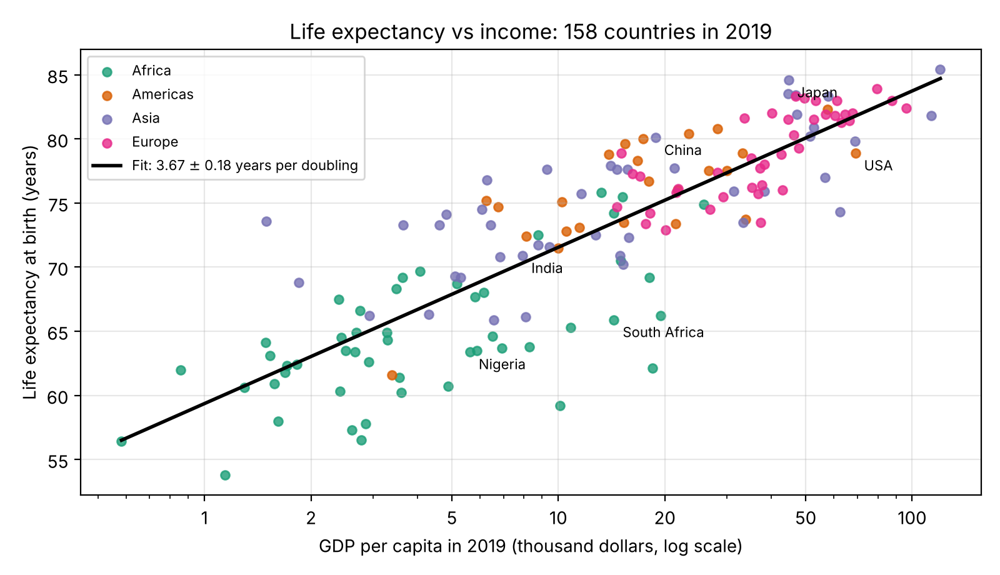

# Does Money Buy a Longer Life? The Preston Curve

**Author:** Szymon Stembalski (i6389327)

This is the data-analysis project for **MAT2007 Introduction to Programming** at Maastricht University.

## Research question

**How many years of life expectancy go together with a doubling of a country's income? And is this gain smaller for rich countries than for poor ones?**

## Dataset

- **Source:** [Gapminder Fast Track dataset](https://github.com/open-numbers/ddf--gapminder--fasttrack), compiled by the Gapminder Foundation from UN, World Bank and other sources.
- **Version:** pinned to commit [`85af9e1`](https://github.com/open-numbers/ddf--gapminder--fasttrack/tree/85af9e1b82e5f5de64b2ad52c5fe2bd1c47b074b) so the results are reproducible.
- **Files used:**
  - `ddf--datapoints--lex--by--country--time.csv`: life expectancy at birth (years)
  - `ddf--datapoints--gdp_pcap--by--country--time.csv`: GDP per capita (international $, PPP, inflation-adjusted)
  - `ddf--datapoints--pop--by--country--time.csv`: population
  - `ddf--entities--geo--country.csv`: country names and world regions

You do **not** need to download the data yourself. On its first run, `analysis.py` downloads the four files (about 4 MB) into `data/`. The script also does all the cleaning, so no manual preparation is needed. It:
1. keeps only the year 2019, the last year before COVID-19;
2. drops countries with fewer than 1 million inhabitants.

That leaves 158 countries, each with complete data.

## What the script does

1. It fits `life expectancy = a + b · log2(GDP per capita)` by least squares. The slope `b` is the number of years of life expectancy per doubling of income.
2. It repeats the fit for the poorer and the richer half of the countries (split at the median income) and compares the two slopes.
3. It lists the countries that live much longer or shorter than their income predicts.
4. It prints all results and saves a figure and a table in `figures/`.

## Main result

| Sample | Years of life expectancy per doubling of income |
|---|---|
| All 158 countries | **3.67 ± 0.18** (r = 0.85, R² = 0.73) |
| Poorer half | 3.64 ± 0.45 |
| Richer half | 3.46 ± 0.47 |

The two halves agree within 0.3σ, so each doubling of income adds about the same number of years for poor and rich countries alike. In dollars, however, a doubling is far cheaper for a poor country. Going from $1,000 to $2,000 adds as many years as going from $50,000 to $100,000. That is why the curve flattens on a linear income axis.



## Repository structure

```
analysis.py               # the analysis code
requirements.txt          # Python dependencies
figures/                  # output (created by analysis.py)
  preston_curve.png       # main figure
  country_data.csv        # data, fit prediction and residual for every country
report/
  MAT2007Project.pdf      # the compiled report (2 pages + title page)
  main.tex                # report source, written in the course Overleaf template
  figures/                # figures used by the report
data/                     # dataset (downloaded automatically, not committed)
```

## How to run

### Requirements
- Python 3.9 or newer (tested with Python 3.13)
- The packages in `requirements.txt`: pandas, numpy, scipy, matplotlib
- An internet connection on the first run, to download the data

### Installation
```bash
git clone <this-repository-url>
cd <repository-folder>
python3 -m venv .venv
source .venv/bin/activate        # Windows: .venv\Scripts\activate
pip install -r requirements.txt
```

### Execution
```bash
python3 analysis.py
```
To run it in **VS Code**, open the folder, select the `.venv` interpreter (Ctrl+Shift+P → *Python: Select Interpreter*), open `analysis.py` and press ▶ *Run Python File*.

The script prints the results to the terminal and saves `figures/preston_curve.png` and `figures/country_data.csv`. It takes a few seconds.

If you are offline, download the four files from the pinned links above and save them in `data/` under their original file names.

### Building the report
The report is written in the course's Overleaf template. Copy `report/main.tex` into the Overleaf project, upload `figures/preston_curve.png` into its `figures/` folder next to `MSP-logo.jpg`, and recompile.
